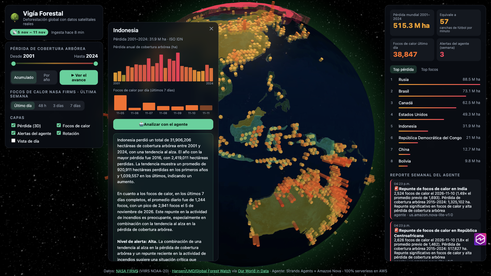
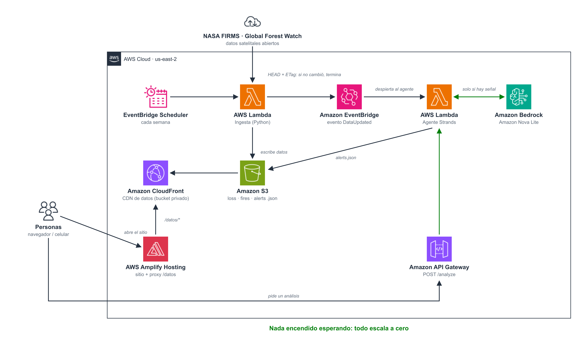

# 🌳 Vigía Forestal

Demo de la charla **"IA que no cuesta el planeta"** (ESCOM-IPN 2026): un globo 3D con la
deforestación global hecho con **datos satelitales reales**, un **agente Strands con Amazon Nova Lite**
y una arquitectura **100% serverless** que solo consume cuando hay trabajo.

🌎 **En vivo:** https://www.apps.vigiaforestal.hazelsaenz.tech



## Datos (reales, públicos, sin API key)

| Capa | Fuente | Frecuencia |
|---|---|---|
| Pérdida de cobertura arbórea por país, 2001–2024 | Hansen/UMD/Google/USGS/NASA vía Global Forest Watch, procesado por Our World in Data | anual |
| Focos de calor (últimos 7 días) | NASA FIRMS · VIIRS NOAA-20 | se ingiere semanalmente |
| Fronteras | Natural Earth 1:110m | — |

> Pérdida de cobertura arbórea ≠ solo deforestación: incluye incendios, tala y agricultura.
> Un foco de calor tampoco es prueba de deforestación; el agente lo trata como señal.

## Arquitectura



- **Cada semana**, EventBridge Scheduler despierta la **Lambda de ingesta**. Antes de descargar, compara el ETag del archivo de NASA FIRMS; si no cambió, termina en milisegundos.
- La ingesta guarda `loss.json` y `fires.json` en **Amazon S3** y, si hubo datos nuevos, publica `DataUpdated` en **EventBridge**.
- Ese evento despierta la **Lambda del agente** (Strands Agents + **Amazon Nova Lite** en Amazon Bedrock), que escribe su reporte semanal en `alerts.json`.
- El **sitio web** (globo 3D) se sirve desde **AWS Amplify Hosting** con dominio propio. Amplify también hace de proxy de `/datos/*` hacia **Amazon CloudFront**, el CDN de los JSON (bucket privado con OAC). El navegador solo habla con un dominio, así que no hace falta CORS.
- Los análisis bajo demanda entran por **Amazon API Gateway** (`POST /analyze`) a la misma Lambda del agente.

El diagrama se regenera con `python docs/diagram/build_diagram.py <Asset-Package-de-iconos-AWS>`.

Decisiones de "cómputo suficiente" que se pueden contar en la charla:

- **Sin servidores encendidos**: Lambda arm64 (Graviton), sin base de datos. Los datos son archivos JSON en un CDN y el sitio es estático en Amplify Hosting.
- **No se procesa lo que no cambió**: HEAD + ETag antes de descargar 40 MB.
- **El modelo solo despierta si hay señal**: una compuerta en Python puro filtra repuntes de fuego en países con historial de pérdida forestal (≥ 20 000 ha/año). Fuego en pastizal no es deforestación.
- **Modelo correcto, no el más grande**: Nova Lite. El sitio muestra la huella de cada respuesta (tokens, llamadas al modelo, segundos).
- **El modelo decide, los datos ponen las cifras**: las herramientas entregan pico, promedio y totales ya calculados, y las alertas escriben las cifras desde los datos. Así se evitan números inventados.

Mediciones reales del despliegue: ingesta ~5–7 s con 134 MB de RAM; agente ~3–7 s con ~3–9 k tokens por ejecución.

## Uso

```bash
make setup                                   # venv local (Python 3.13, uv)
make local                                   # http://localhost:8000, el mismo código que las Lambdas
make deploy AWS_PROFILE=<tu-perfil>          # SAM + sitio en Amplify + primera ingesta
make site                                    # vuelve a publicar solo el frontend en Amplify
make domain DOMAIN=<dominio> SUBDOMAIN=www   # asocia un dominio propio y muestra los CNAME a crear
make ingest                                  # fuerza una ingesta en la nube
make logs                                    # logs del agente
make destroy                                 # borra todo
```

Requisitos: `uv`, AWS SAM CLI y acceso a Amazon Nova en Bedrock. El modelo se cambia con el parámetro `ModelId`.

## Estructura

```
backend/src/vigia/   config · sources (FIRMS/OWID) · geo (punto→país) · ingest · analysis · agent · handlers/
backend/layer/       capa Strands (wheels Linux arm64, se compila con uv)
frontend/            index.html · app.js (globe.gl/three.js) · vendor/ (librería y texturas sin depender de un CDN)
local/dev_server.py  imita Scheduler, EventBridge, S3 y la API en una sola terminal
docs/                diagrama (arquitectura.svg/png + generador) · record_demo.py (video del demo)
template.yaml        infraestructura SAM (Lambda, EventBridge, S3, CloudFront, API Gateway, Amplify)
```
